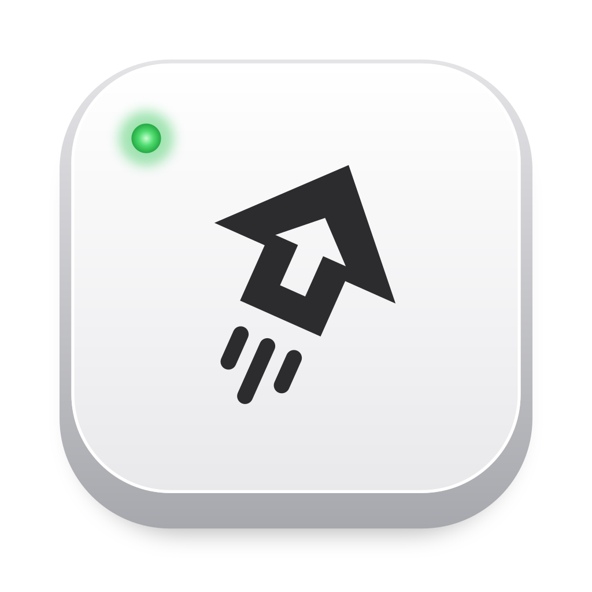

<p align="center">
  
</p>

<h1 align="center">CapsJump</h1>

<p align="center">Caps Lock finally has a job: one key to the right app, window or tab, in the Chrome profile you choose.</p>

<p align="center">
  <a href="https://github.com/whysosuresh/capsjump/releases/latest"></a>
  
  <a href="LICENSE"></a>
</p>

<p align="center"><a href="https://capsjump.com/">capsjump.com</a></p>

Caps Lock has spent decades waiting for someone to SHOUT. CapsJump gives it a real job. Give GitHub a key in your work Chrome profile: hold Caps Lock and press G, and CapsJump brings a matching tab forward when it can find one. If no tab matches, it opens the page in that profile. It also brings apps forward, snaps windows and opens links. One small file, `~/.capsjump.yaml`, says which key does what; G is an example you configure below.

## Install

### Download

[Download for Mac](https://github.com/whysosuresh/capsjump/releases/latest). Opens the latest GitHub release. Download the CapsJump ZIP under Assets.

Unzip it, move **CapsJump.app** to Applications, and open it.

### Homebrew

```sh
brew install --cask whysosuresh/tap/capsjump
open -a CapsJump
```

Open source. CapsJump has no analytics. Quit CapsJump and Caps Lock works normally again.

Accessibility lets CapsJump handle your shortcuts and move windows. Chrome access lets it find and switch tabs. Configuration and saved icons are read locally; websites and apps you open make their own connections.

### Set up your keys

Both routes open the same Welcome window, with three steps that tick themselves as you go:

1. **Let CapsJump hear Caps Lock.** macOS asks with its own box: click Open System Settings there and turn CapsJump on (or use the step's own button if you closed the box). The step ticks the moment you do, and upgrades keep the permission.
2. **Choose your keys.** One click turns on the starter keys (Caps Lock with the arrows snaps the front window to a half, with F it fills the screen), or set up your own. Nothing takes Caps Lock before this, and the step says so plainly: while CapsJump has keys, Caps Lock no longer types capitals (Shift still does).
3. **Try it.** Click any window, hold Caps Lock and press ←.

Notifications and Start at login have their own controls in the Welcome window. Close it whenever you like; until CapsJump is set up, its menu-bar mark carries a small dot and its menu starts with **Finish Setting Up…**. Opening CapsJump again brings the window back.

### Give GitHub a key

G is an example you configure; the starter keys move windows.

1. In the Welcome window, choose **Allow…** under **Chrome accounts**. If access was previously denied, choose **Open Automation Settings** instead.
2. Open GitHub in the Chrome profile you want, then choose **Add Current Tab…** from CapsJump's menu.
3. When the **Account** field is shown, confirm the intended profile; select it if it says **Choose…**. Assign G or another available key, then choose **Add** or **Add Key**.
4. Hold Caps Lock and press the key you assigned.

CapsJump chooses the Chrome profile, not the account signed in on a website. See [What a jump does](#what-a-jump-does) for tab-reuse limits.

Homebrew also makes `capsjump` available on PATH. With ZIP installation, use the app's menus, or run the bundled CLI at `/Applications/CapsJump.app/Contents/Helpers/capsjump`. `capsjump setup` opens the Welcome window, `capsjump init` writes the starter configuration, `capsjump profiles` lists Chrome profiles and `capsjump check` checks the file.

Homebrew loads a cask from outside its own taps only once you trust it; naming the cask in full, as above, trusts this one cask and nothing else.

## Configure

The quickest way: open a page in Chrome and pick **Add Current Tab…** from CapsJump's menu, or open **Edit Config…** for a window with every site and key: Sites, Keys and Windows on the left, every site, key or window move as one line you can search in the middle, and the one you pick open for editing on the right. Each field is checked as you type, by the same rules `capsjump check` uses, and saving applies at once.

<p align="center">
  <picture>
    <source media="(prefers-color-scheme: dark)" srcset="site/editor-keys-dark.png">
    
  </picture>
</p>
<p align="center">
  <picture>
    <source media="(prefers-color-scheme: dark)" srcset="site/editor-sites-dark.png">
    
  </picture>
</p>
<p align="center">
  <picture>
    <source media="(prefers-color-scheme: dark)" srcset="site/editor-windows-dark.png">
    
  </picture>
</p>

Underneath it's one small file, `~/.capsjump.yaml`, which you can also edit by hand:

```yaml
sites:
- name: github
  account: you@work.com
  open: https://github.com/your-org/your-repo/pulls
  match: [github.com/your-org/your-repo/pulls, github.com/]
- name: claude-client
  account: client@example.com
  open: https://claude.ai/new

keys:
  s: {app: iTerm}
  t: {app: Finder}
  o: {app: ~/Applications/Obsidian.app}
  g: {site: github}
  f1: {site: claude-client}
  left: {window: left-half}
  right: {window: right-half}
  up: {window: top-half}
  down: {window: bottom-half}
  f: {window: maximize}
  w: {url: 'slack://channel?team=T123&id=C456'}
```

### Keys

Each entry under `keys:` is Caps Lock + one key. Key names: `a`–`z`, `0`–`9`, `f1`–`f12`, `left`, `right`, `up`, `down`. On an Apple keyboard, `f1`–`f12` work with or without fn. Each key does exactly one thing:

- `app`: an app's name, such as `Slack`, or a path to an .app that starts with `/` or `~/`. A name is looked for in `/Applications`, `/Applications/Utilities`, `/System/Applications`, `/System/Applications/Utilities`, `~/Applications` and `/System/Library/CoreServices`, in that order. The app comes forward, starting if it isn't running and opening a window if it has none.
- `site`: one of the sites below. See [What a jump does](#what-a-jump-does).
- `window`: `left-half`, `right-half`, `top-half`, `bottom-half` or `maximize` (fill the screen, staying on this desktop), for the front window, within the screen it is on. `top-half` and `bottom-half` need CapsJump 0.6.0 or later; if this file syncs to a Mac with an older CapsJump, that Mac refuses the file and keeps its last keys until it is updated.
- `url`: any link with a scheme. It opens the way a clicked link does: `slack://…` or `zoommtg://…` in the app that owns it, `https://…` in your default browser. Unlike `site`, it opens afresh each time; use `site` to land on a tab that is already open in a Chrome account.

While Caps Lock is held, a key with nothing bound does nothing. A file with no `keys:` leaves Caps Lock as it is.

### Sites

- `name`: the site's name, lower-case letters, digits and hyphens. Each site is also the link `capsjump://<name>`, for launchers and scripts.
- `account`: the account's email, or the profile's name for a profile with no signed-in account. `capsjump profiles` lists both.
- `profile`: a profile folder (`Profile 26`) instead of, or as well as, `account`, for when two profiles share an account or a name.
- `open`: the page opened when no tab matches.
- `match`: URL prefixes without the scheme, most specific first. A tab matches when its URL (without `https://` and `www.`) starts with one. The default is the `open` URL's host, e.g. `claude.ai/`.

This is the layout CapsJump itself writes, and a file in it never loses anything when CapsJump saves it. A file with comments or a layout of its own is rewritten only after CapsJump asks; `capsjump check` notes such a file, and `capsjump tidy` rewrites it in CapsJump's layout (dropping its comments). Edits apply as soon as the file is saved. Unknown keys are refused, so a typo is reported instead of being ignored. A broken edit keeps the keys you had and says what is wrong in a notification, and `capsjump check` lists every problem with its line.

### With a coding agent

Rather tell your coding agent? Install CapsJump's skill once:

```sh
npx skills add whysosuresh/capsjump
```

That works for Claude Code, Codex, Cursor, Gemini CLI and other agents that read skills. In Claude Code you can install it as a plugin instead, with `/plugin install capsjump --marketplace whysosuresh/capsjump` (before Claude Code 2.1.275: `/plugin marketplace add whysosuresh/capsjump`, then `/plugin install capsjump@capsjump`).

Then ask in your own words: "Caps Lock + G should open our pull requests in my work Chrome, and Caps Lock + S my terminal." The agent offers to install CapsJump if it isn't there, looks up your Chrome accounts with `capsjump profiles --json` instead of guessing an email, keeps your other keys, asks before taking a key that's in use, runs `capsjump tidy` and then `capsjump check --json` until the file is clean, and tells you each new key in a line. What only you can do, such as granting Accessibility, it hands back to you. The skill lives in [`skills/capsjump/SKILL.md`](skills/capsjump/SKILL.md).

## How Caps Lock becomes CapsJump's key

While CapsJump runs, macOS's own key mapping (the one `hidutil` sets) turns Caps Lock into F18, a key no keyboard has, and CapsJump watches for it. Caps Lock then no longer types capitals and its light stays off. Miss SHOUTING? Hold Shift, like everyone else. CapsJump gives Caps Lock back whenever it quits: from its own quit, at logout, when stopped, and when uninstalled with Homebrew. If it ever crashes, Caps Lock does nothing until CapsJump starts again or the Mac restarts.

macOS keeps every app's shortcuts out of password fields, so the keys do nothing while one has focus and work again as soon as you leave it.

## Pause, quit or turn it off

CapsJump puts its mark in the menu bar: filled while it has Caps Lock, dimmed while it doesn't (paused, or no keys), and with a small dot while something waits on you (not set up yet, Accessibility missing, or a config with a problem). Its menu starts with CapsJump's version and what the keys are doing, then the one thing that would move things on, when there is one: **Finish Setting Up…**, **Resume Keys** or **Fix the Config…**. Then:

- **Pause Keys**: gives Caps Lock back until you choose Resume Keys. A pause lasts across restarts. Shown while there are keys to pause.
- **Add Current Tab…**: turns the tab in front of Chrome into a site with a key. The page and its account come filled in, with a free key suggested; to change it, click the key and press the one you want. Click Add, and Caps Lock with that key lands there from then on. If the page is already one of your sites, it offers that site another key instead.
- **Edit Config…**: a window with Sites, Keys and Windows in a sidebar, a searchable list of each, and an editor for the one you pick. Keys holds the keys that take you somewhere (an app, a site with its own icon, a link); Windows lists every move CapsJump can make, each with the key that does it, which you can change or turn off. Accounts (each with its picture, as Chrome's profile menu shows it) and sites are picked from lists, apps from a searchable list with their icons; a key is set by clicking its field and pressing the key, alone or with Caps Lock held, and a key that is taken or that CapsJump can't use is explained right there (Escape cancels, and in Windows Delete turns the move's key off); problems show under their field as you type, and Save (⌘S) applies at once. Rename a site and its keys come along. ⌘N adds, ⌫ removes (in Windows, turns the move's key off), ⌘F searches, ⌘1, ⌘2 and ⌘3 switch between Sites, Keys and Windows. Close or quit with unsaved changes and it asks first.
- **Open Config File**: opens `~/.capsjump.yaml` in your editor, writing a starter file first if there is none. Saving applies the change at once.
- **Check Config**: shows what `capsjump check` shows, with a button to Edit Config….
- **Getting Started…**: the Welcome window again, with every permission's state.
- **Start at Login**: whether CapsJump starts when you log in.
- **About CapsJump**: the version, in macOS's own About panel.
- **Quit CapsJump**: gives Caps Lock back. It starts again at the next login, unless Start at Login is off. Quitting from outside (`capsjump quit`, Homebrew, logging out) never waits on unsaved changes in the window; it drops them, because Caps Lock coming back matters more.

From a terminal: `capsjump pause`, `capsjump resume` and `capsjump quit`. To remove it: `brew uninstall --cask capsjump`, which quits it first.

## What a jump does

A `site` key, or the link `capsjump://<name>`, runs a jump:

1. Finds the site's Chrome profile from Chrome's own profile list.
2. If Chrome is running, looks through that profile's windows, front to back, for a tab whose URL matches the first `match` prefix, then the next, preferring a window's active tab. It brings that tab and its window to the front.
3. Otherwise it opens the `open` page in that profile: a new tab in its window, or a new window, starting Chrome if needed.

Chrome's scripting interface doesn't say which profile a window belongs to, but its window title does (it ends in `– <profile label>`), and macOS Accessibility reads that title. CapsJump pairs each Chrome window with its title, so a window's profile is known without guessing. Accessibility lists only the windows on the current Space, so CapsJump sees only those: from a full-screen window or another desktop, a site whose tab is in a window elsewhere gets a new tab instead of being focused. Keep Chrome's windows on one desktop and out of full screen for jumps to find them. If two profiles carry the same label, their windows can't be told apart, so their sites always open a new tab; `capsjump check` says when that applies.

If a permission is missing, the jump fails with a notification. So does a jump whose window doesn't come to the front within half a second; the notification names the app that stayed in front. It never opens a duplicate tab instead, and never tries again by itself.

## Permissions

The Welcome window explains each permission. Accessibility follows macOS's permission flow; Chrome access and notifications have separate **Allow…** buttons:

- **Accessibility**, for the keys, to move windows, and to read Chrome's window titles and raise a window. The keys start by themselves as soon as it is granted.
- **Automation of Google Chrome**, to read and switch tabs.
- **Notifications**, to say why a key or a jump did nothing.

If Chrome access or notifications were previously denied, the Welcome window offers **Open Automation Settings** or **Open Notification Settings**. **Start at login** is a separate switch there; it can also be changed from CapsJump's menu.

Releases are signed with a Developer ID and notarized, so macOS keeps these grants across upgrades.

Site icons need no permission: the config window shows the icon Chrome has already saved on this Mac for each site, in the account the site jumps into, and each account's picture, from the same folder; it fetches nothing. A site Chrome hasn't shown in that account yet keeps a globe until it has, and an account without a Google picture shows Chrome's own outline in that profile's colours.

## Commands

| Command | |
| --- | --- |
| `capsjump init` | Write a starter `~/.capsjump.yaml`. Never overwrites. |
| `capsjump profiles [--json]` | List Chrome's profiles: folder, account, name and window label. `--json` adds the folders sharing each label and the fields a site in each profile writes. |
| `capsjump check [--json]` | Validate the file, resolve every site and key, and confirm CapsJump.app is running with Caps Lock mapped. Exits non-zero on a problem. `--json` gives the file it read (symlinks followed) and its findings about the file apart from those about the app. |
| `capsjump tidy` | Rewrite `~/.capsjump.yaml` in the layout CapsJump writes, as Edit Config… saves it. Comments don't survive; a file with problems is left as it is. |
| `capsjump jump <site>` | Jump, exactly as the link does. |
| `capsjump setup` | Ask for the permissions, start CapsJump at login, and show each one's state. |
| `capsjump pause` / `capsjump resume` | Give Caps Lock back, or take it again. |
| `capsjump quit` | Quit CapsJump.app, giving Caps Lock back. |
| `capsjump logs [--last 2h]` | Show recent keys, jumps and failures from the macOS log. |
| `capsjump version` | Print the version. |

CapsJump runs from login, with its mark in the menu bar and no Dock icon.

## Develop

Requires Xcode 16 or later (Swift 6).

```sh
make test            # unit tests (Swift Testing)
make app             # .build/bundle/CapsJump.app, universal, signed ad hoc
make install-local   # install that build to ~/Applications and the CLI to ~/.local/bin
```

A local build is signed ad hoc, and macOS ties its permissions to that exact build, so every rebuild asks for them again: `make install-local` clears the old entries, then run `capsjump setup`. Released builds don't have this problem.

Layout:

- `Sources/CapsJumpCore`: all the rules (reading, checking and writing the config, key names, what each key event does, window frames, Chrome profiles, links, window pairing, choosing a tab), with no system calls. Nearly every test is here.
- `Sources/CapsJumpChrome`: the live side of a jump: Apple Events to Chrome, Accessibility, launching Chrome, permissions.
- `Sources/CapsJumpSystem`: the live side of the keys: the Caps Lock mapping, the event tap, watching and saving the config, moving windows, opening apps and links. Saving has its own tests, on a real disk, because its bugs would lose your file.
- `Sources/CapsJumpApp`: the background app that runs the keys and receives `capsjump://` links.
- `Sources/capsjump`: the CLI.
- `scripts/make-icon.sh` holds the mark and its colours, and writes every file that shows it: `packaging/icon.svg` and `packaging/AppIcon.icns` (the app icon), `packaging/menubar.svg` and `packaging/MenuBarIcon*.png` (the menu bar's), `site/icon.svg` and `site/icon.png` (the site's and the iPhone touch icon). Change the mark there, never in those files; CI runs `scripts/make-icon.sh --check` to keep them current.
- `site/` is the website, hand-written with no build; `.github/workflows/pages.yaml` publishes it to GitHub Pages when it changes on `main`.
- `skills/capsjump/SKILL.md` is the skill coding agents install, and `.claude-plugin/` makes this repository its Claude Code marketplace and plugin. A change to the config's rules updates the skill in the same PR; `SkillReferenceTests` fails when a window move or an action is missing from it.
- `scripts/bundle.sh` builds the app bundle; `scripts/notarize.sh` and `scripts/macos-import-signing-keychain.sh` are the signing steps, which `.github/actions/signed-build` runs for both the release and the signed build below.

## Release

Bump `VERSION`, merge, and push the tag `v<VERSION>`. `.github/workflows/release.yaml` tests, builds, signs, notarizes and staples, publishes the GitHub release, and updates the cask in [whysosuresh/homebrew-tap](https://github.com/whysosuresh/homebrew-tap). It needs the repository secrets listed at the top of that workflow.

To try a change that only a signed build can prove (how a window is brought forward, say), run the Signed build workflow on its branch: `gh workflow run signed-build.yaml --ref <branch>`. It tests, signs and notarizes exactly as a release does, and keeps the zip as a run artifact for a day, without releasing anything. The repository is public, so delete the artifact once downloaded.

## License

MIT
